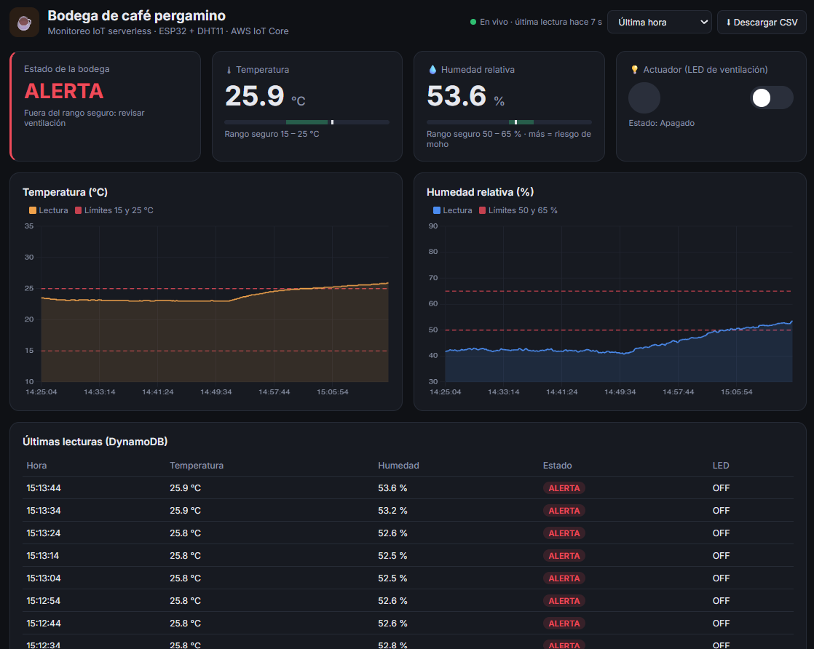
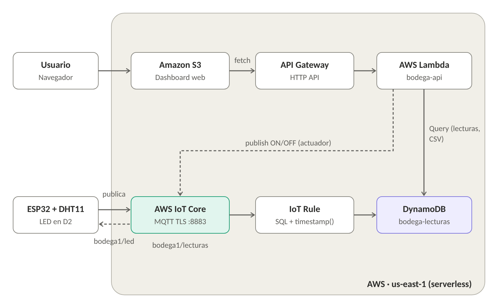

# ☕ Bodega de café pergamino — IoT serverless en AWS

Un **ESP32 con sensor DHT11** mide la temperatura y la humedad de una bodega de café pergamino y
las publica por **MQTT** en **AWS IoT Core**. Una **regla de IoT** guarda cada lectura en
**Amazon DynamoDB**, y un **dashboard web alojado en Amazon S3** muestra los datos, permite
**descargarlos en CSV** y **controlar un actuador** (LED) de forma remota a través de
**API Gateway** y **AWS Lambda**. No hay servidores que administrar: todo es serverless.

**Dashboard:** http://bodega-cafe-dashboard-jorge.s3-website-us-east-1.amazonaws.com/
(solo funciona mientras el Learner Lab está encendido)

> Este repo es la **Actividad 3** del curso. Las Actividades 1 (HTTP, local y AWS) y 2 (MQTT con
> Mosquitto, InfluxDB y Grafana) están en
> [bodega-cafe-iot](https://github.com/jorgegonzalezgom-create/bodega-cafe-iot).



---

## El caso de uso

Una cooperativa cafetera guarda **café pergamino seco** antes de venderlo. Si la humedad sube, el
grano la absorbe, aparece **moho** y el café pierde puntaje de taza y precio.

| Variable | OK (rango seguro) | ALERTA |
|---|---|---|
| Temperatura | 15 – 25 °C | fuera de ese rango |
| Humedad relativa | 50 – 65 % | > 65 % (riesgo de moho) o < 50 % (el grano se reseca) |

El **actuador** (LED en D2) representa el **ventilador / deshumidificador** de la bodega: se
enciende y apaga desde el dashboard.

## Arquitectura



```mermaid
flowchart LR
    ESP[ESP32 + DHT11] -- "MQTT TLS :8883<br/>bodega1/lecturas" --> IOT[AWS IoT Core]
    IOT -- "bodega1/led" --> ESP
    IOT --> RULE[IoT Rule<br/>SELECT *, timestamp() AS ts] --> DDB[(DynamoDB<br/>bodega-lecturas)]
    USR[Usuario] --> S3[S3 · dashboard web] -- fetch --> API[API Gateway<br/>HTTP API]
    API --> LAMBDA[Lambda bodega-api]
    LAMBDA -- "Query (JSON / CSV)" --> DDB
    LAMBDA -- "publish ON/OFF" --> IOT
```

| Servicio | Para qué |
|---|---|
| **AWS IoT Core** | Bróker MQTT administrado. El ESP32 se autentica con **certificado X.509** (TLS mutuo, puerto 8883) |
| **IoT Rule** | Toma cada mensaje de `bodega1/lecturas`, le agrega la hora de llegada y lo guarda en DynamoDB |
| **Amazon DynamoDB** | Base de datos NoSQL sin servidor. Tabla `bodega-lecturas` |
| **AWS Lambda** | Función `bodega-api`: devuelve lecturas (JSON), genera el CSV y envía el comando al LED |
| **Amazon API Gateway** | URL pública (HTTP API) que el dashboard llama con `fetch` |
| **Amazon S3** | Aloja el dashboard (`index.html`) como sitio web estático |

## Flujo de un dato

1. El ESP32 lee el DHT11, calcula el estado y arma el JSON
   `{"dispositivo":"bodega-esp32","temperatura":23.8,"humedad":43.7,"estado":"ALERTA","led":"OFF"}`.
2. Lo **publica por MQTT** en `bodega1/lecturas`, sobre una conexión **TLS** al endpoint de IoT
   Core (puerto 8883), presentando su certificado.
3. **IoT Core** valida el certificado y la política, y entrega el mensaje a la **regla**.
4. La regla ejecuta `SELECT *, timestamp() AS ts FROM 'bodega1/lecturas'` y, con la acción
   **DynamoDBv2**, guarda cada campo como una columna en `bodega-lecturas`.
5. El **dashboard** (S3) llama cada 10 s a `GET /lecturas`; **API Gateway** invoca la **Lambda**,
   que consulta DynamoDB y devuelve las lecturas en JSON.

**Actuador:** el interruptor del dashboard hace `POST /led {"estado":"ON"}` → Lambda publica `ON`
en `bodega1/led` → IoT Core lo entrega al ESP32 (suscrito a ese tema) → el LED se enciende.

## Comunicación, almacenamiento y consulta

| Aspecto | Cómo funciona |
|---|---|
| **Protocolo** | MQTT sobre TLS (puerto 8883). Publicar/suscribir: el ESP32 publica lecturas y se suscribe a los comandos |
| **Temas** | `bodega1/lecturas` (ESP32 → AWS) · `bodega1/led` (AWS → ESP32, `ON`/`OFF`) |
| **Seguridad** | Certificado del dispositivo + llave privada + Amazon Root CA 1. Política con mínimo privilegio: solo el cliente `bodega-esp32` y solo temas `bodega1/*` |
| **Almacenamiento** | DynamoDB `bodega-lecturas`: clave de partición `dispositivo` (String) y de ordenación `ts` (Number, ms) |
| **Consulta** | Consola de DynamoDB (*Explorar elementos*), API `GET /lecturas?horas=1`, CSV `GET /lecturas/csv?horas=24`, dashboard |

## Estructura del repo

```
esp32/esp32_iotcore/
  esp32_iotcore.ino       Sketch: TLS + MQTT a IoT Core, publica lecturas, recibe comando del LED
  secrets.example.h       Plantilla: WiFi, endpoint y certificados (copiar como secrets.h)
aws-iot/
  policy.json             Política de IoT del dispositivo
  regla.sql               Instrucción SQL de la regla
lambda/
  lambda_function.py      API: /lecturas, /lecturas/csv y /led
dashboard/
  index.html              Dashboard (HTML + CSS + JS con Chart.js)
  bucket-policy.json      Política pública de lectura del bucket S3
docs/                     Diagrama y capturas
```

## Paso a paso

Todo se hizo en el **AWS Academy Learner Lab** (región `us-east-1`). En el lab no se pueden crear
roles de IAM: Lambda y la regla de IoT usan el rol existente **`LabRole`**.

### 1. Registrar el dispositivo en IoT Core

1. *IoT Core → Seguridad → Políticas → Crear política* `bodega-esp32-policy` con el JSON de
   [aws-iot/policy.json](aws-iot/policy.json) (reemplazar `<ID_CUENTA>`).
2. *Administrar → Objetos → Crear objeto* `bodega-esp32` → *Generar certificado automáticamente* →
   asociar la política.
3. **Descargar** el certificado del dispositivo, la llave privada y **Amazon Root CA 1** (la llave
   solo se descarga una vez).
4. Endpoint del bróker (en CloudShell):
   ```bash
   aws iot describe-endpoint --endpoint-type iot:Data-ATS
   ```

### 2. Programar el ESP32

1. Librerías (Arduino IDE): **PubSubClient** (Nick O'Leary) y **DHT sensor library** (Adafruit).
2. Copiar `secrets.example.h` como `secrets.h` y pegar WiFi (2,4 GHz), endpoint y el contenido
   completo de los tres certificados.
3. Conexiones: DHT11 datos → D4, + → 3V3, − → GND · LED (con resistencia de 220 Ω) → D2 y GND.
4. Cargar el sketch. En el Monitor serie (115200):
   ```
   Conectando a AWS IoT Core... OK
   {"dispositivo":"bodega-esp32",...} -> publicado
   ```
5. Verificar en *IoT Core → Probar → Cliente de prueba de MQTT*: suscribirse a `bodega1/#`.
   Para probar el LED, publicar `ON` (sin comillas ni llaves) en `bodega1/led`.

### 3. DynamoDB + regla de IoT

1. *DynamoDB → Crear tabla* `bodega-lecturas`: partición `dispositivo` (String), ordenación `ts`
   (Number).
2. *IoT Core → Enrutamiento de mensajes → Reglas → Crear regla* `bodega_guardar_lecturas`:
   - SQL: `SELECT *, timestamp() AS ts FROM 'bodega1/lecturas'`
   - Acción: **DynamoDBv2** → tabla `bodega-lecturas` → rol **`LabRole`**.
   - La consola intenta agregar una política a `LabRole` y muestra un error de permisos; la regla
     igual se crea y funciona porque `LabRole` ya tiene acceso a DynamoDB.
3. Verificar en *DynamoDB → bodega-lecturas → Explorar elementos*.

### 4. Lambda + API Gateway

1. *Lambda → Crear función* `bodega-api`, **Python 3.12**, rol existente **`LabRole`**. Pegar
   [lambda/lambda_function.py](lambda/lambda_function.py) (ajustar `IOT_ENDPOINT`) → *Deploy*.
   Tiempo de espera: 10 s.
2. *API Gateway → Crear API → API HTTP* `bodega-api`, integración Lambda `bodega-api`, rutas:

   | Método | Ruta | Qué hace |
   |---|---|---|
   | GET | `/lecturas?horas=1` | Lecturas en JSON |
   | GET | `/lecturas/csv?horas=24` | Descarga CSV |
   | POST | `/led` con `{"estado":"ON"}` | Enciende/apaga el LED |

   Etapa `$default` con implementación automática.
3. **CORS:** Allow-Origin `*`, Allow-Methods `GET, POST`, Allow-Headers `content-type`.
4. Probar: `https://<ID_API>.execute-api.us-east-1.amazonaws.com/lecturas`.

### 5. Dashboard en S3

1. En [dashboard/index.html](dashboard/index.html), poner la URL de la API en `const API = ...`.
2. *S3 → Crear bucket* `bodega-cafe-dashboard-jorge` (espacio de nombres global, **desmarcar**
   *Bloquear todo el acceso público*).
3. *Propiedades → Alojamiento de sitios web estáticos → Habilitar*, documento de índice
   `index.html`.
4. *Permisos → Política del bucket*: [dashboard/bucket-policy.json](dashboard/bucket-policy.json).
5. Cargar `index.html` y abrir el *punto de conexión del sitio web*.

El dashboard muestra el estado (OK/ALERTA), la temperatura y humedad actuales con su rango seguro,
el interruptor del actuador, las gráficas con los límites, una tabla con las últimas lecturas, un
selector de rango (1, 6 o 24 h) y el botón **Descargar CSV**. Se actualiza cada 10 s.

## Verificar

| Qué | Dónde |
|---|---|
| El ESP32 publica | Monitor serie: `-> publicado` · Cliente de prueba MQTT: `bodega1/#` |
| Los datos se guardan | DynamoDB → `bodega-lecturas` → Explorar elementos |
| La API responde | `GET /lecturas` en el navegador |
| CSV | Botón *Descargar CSV* o `GET /lecturas/csv` |
| Actuador | Interruptor del dashboard → Monitor serie: `Comando recibido [bodega1/led]: ON` |

## Problemas frecuentes

| Síntoma | Solución |
|---|---|
| `fallo (estado -2)` al conectar | Endpoint mal escrito o certificados incompletos (deben incluir las líneas BEGIN/END) |
| Conecta y se desconecta enseguida | El `THING_NAME` no coincide con la política (`client/bodega-esp32`) o la política no está asociada al certificado |
| "No puede publicar en un tema comodín" | En el cliente de prueba, `#` solo sirve para suscribirse; publicar en `bodega1/led` |
| El LED no responde al publicar | La carga útil debe ser `ON` u `OFF` sin llaves ni comillas |
| DynamoDB vacío | Revisar que la regla esté *Activa* y escuche `bodega1/lecturas` |
| Dashboard: "No se pudo leer la API" | Falta configurar CORS en API Gateway o la URL de `const API` es incorrecta |
| Nada responde | El Learner Lab está apagado: *Start Lab* |

## Seguridad y limitaciones

- `secrets.h` y los archivos `.pem`/`.key` están en `.gitignore`: **la llave privada nunca se sube**.
  Si se filtra, se desactiva el certificado en *IoT Core → Seguridad → Certificados* y se genera otro.
- La API de API Gateway no pide autenticación: cualquiera con la URL puede leer los datos o mover
  el LED. Para producción se agregaría Amazon Cognito o una clave de API.
- El dashboard en S3 se sirve por HTTP; para HTTPS se pondría Amazon CloudFront delante.
